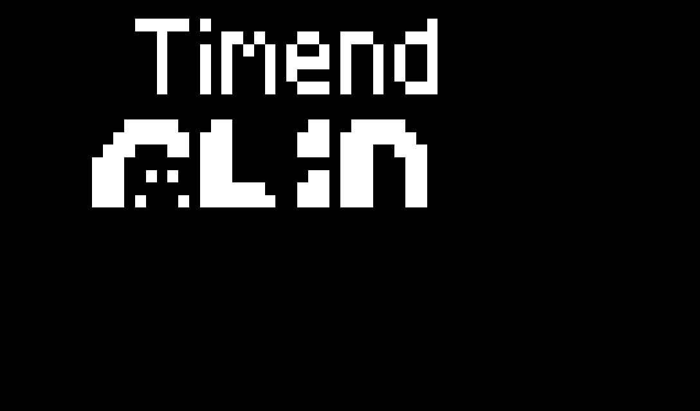
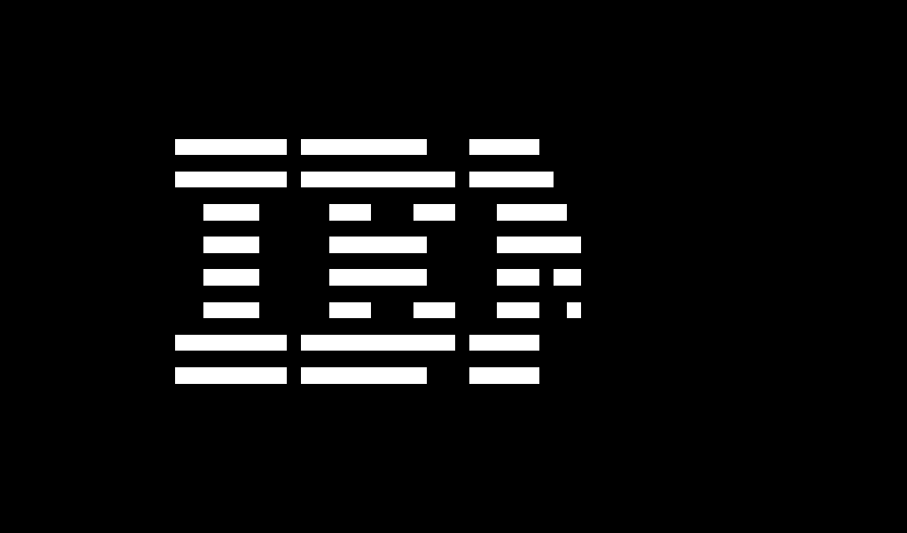
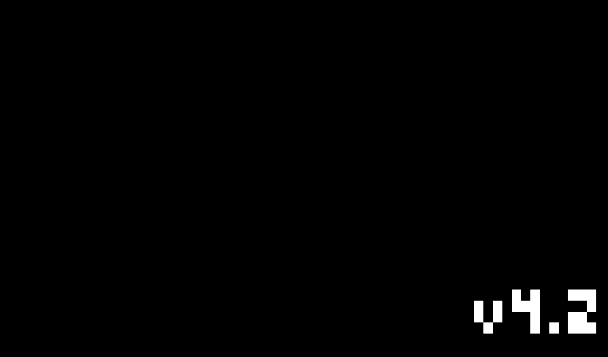
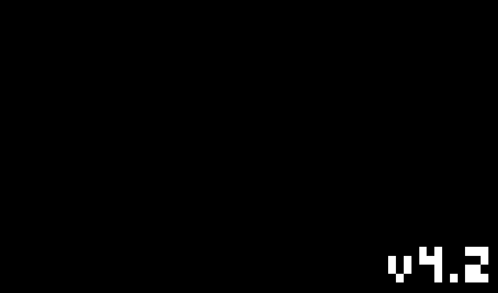
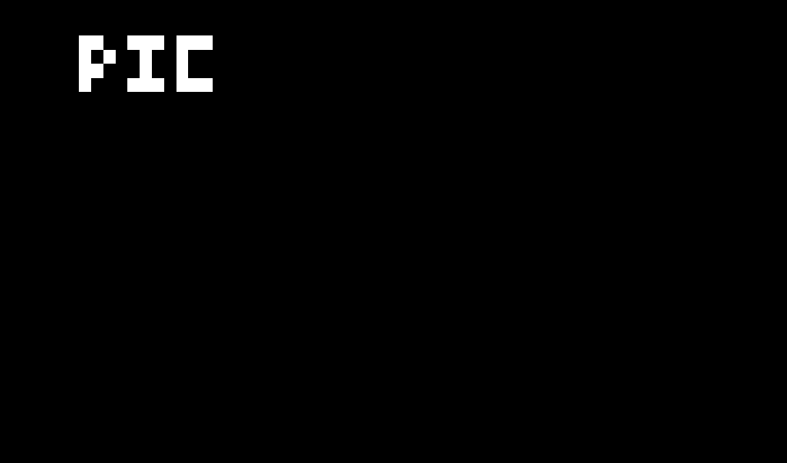

# RSC8

_RSC8_ is a CHIP-8 virtual machine/emulator written in Rust 🦀 with **no_std** core

## How to use

```bash
cargo install --locked --git https://github.com/jerryshell/rsc8
```

```bash
rsc8_tui <your_rom.ch8>
```

By default `8XY6` and `8XYE` shift `VX` in place, like most interpreters and
the games of that era expect. Pass `--vip` for the behaviour of the original
interpreter instead: the COSMAC VIP (RCA, 1977), the machine CHIP-8 was written
for. It shifts `VY` into `VX`, which is also what the CHIP-8 platform of the
test suite checks:

```bash
rsc8_tui --vip <your_rom.ch8>
```

## Keymap

```text
PC           CHIP-8
--------------------
1 2 3 4      1 2 3 C
Q W E R  =>  4 5 6 D
A S D F      7 8 9 E
Z X C V      A 0 B F
```

Press `Esc` to exit

## Display

The screen is refreshed 60 times per second. When a program turns a pixel off,
it stays lit for a moment and then fades out over the next few frames, much like
the phosphor of the original displays did. This keeps sprites that some ROMs
blink on and off visible instead of strobing.

## Screenshot

chip8-test-suite: CHIP-8 splash screen


chip8-test-suite: IBM logo


chip8-test-suite: Corax+ opcode test


chip8-test-suite: Flags test


chip8-test-suite: Quirks test


chip8-test-suite: Keypad test FX0A


Sierpinski


Tetris


## Testing

```bash
cargo test
```

Besides the unit tests, this runs the ROMs of [Timendus' CHIP-8 test suite] and
compares the results with the screens in `rsc8_core/tests/snapshots`. The ROMs
are not part of this repository: clone the test suite next to it, or point
`RSC8_TEST_SUITE_DIR` at a checkout, to run those tests. Without it they are
skipped.

```bash
git clone https://github.com/Timendus/chip8-test-suite ../chip8-test-suite
cargo test
```

`UPDATE_SNAPSHOTS=1 cargo test` updates the expected screens when the
difference is intended.

## References

- [CHIP-8 Wikipedia](https://en.wikipedia.org/wiki/CHIP-8)
- [CHIP-8 Research Facility](https://chip-8.github.io)
- [CHIP-8 Test Suite](https://github.com/Timendus/chip8-test-suite)
- [CHIP-8 IDE](https://johnearnest.github.io/Octo)

## License

[MIT](LICENSE)
